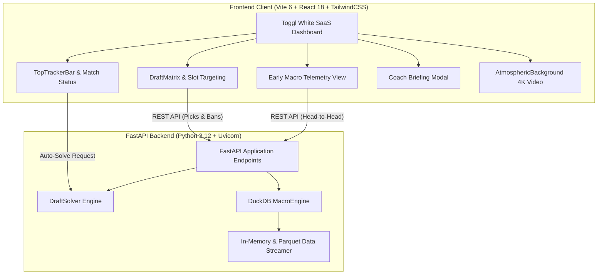

# Cloud9 StratDraft — Fearless Draft & Macro Scouting Engine
> **Cloud9 x JetBrains: Sky's The Limit Hackathon 2026 Submission**  
> *Scout smarter. Draft sharper. Built with JetBrains, DuckDB, FastAPI, and Vite React.*

[](https://github.com/ankush-dev-eng/draft-scout-engine/actions)
[](https://fastapi.tiangolo.com)
[](https://duckdb.org)
[](https://react.dev)
[](https://vitejs.dev)
[](https://tailwindcss.com)
[](https://jetbrains.com)
[](LICENSE)

---

## 1. Executive Summary & Problem Context

In professional League of Legends series play (specifically under the newly mandated **Fearless Draft** rules across LCS and international tier-1 events), champions selected in earlier games are completely locked out of subsequent matches. A Best-of-5 series eliminates up to **40 priority meta champions**, forcing coaching staff into extreme draft fatigue where sub-optimal counter-picks and macro blindspots decide the match.

Existing scouting platforms only provide static win rates or end-game summaries. They fail to address:
1. **Multi-Game Fearless Depletion**: How picking comfort champions in Game 1 cripples draft flexibility in Game 4 and 5.
2. **First 15-Minute Macro Vulnerabilities**: Leash starts, 5:00 Voidgrub rotation timing, and early turret plate conversion deltas.
3. **High-Stress Stage Execution**: Coaches have just **30 seconds** per pick/ban phase to analyze counters and align team composition damage profiles.

**Cloud9 StratDraft** solves this with an integrated tactical console that pairs an **in-process DuckDB telemetry engine** with a **mathematical Fearless constraint solver** and a **Toggl Track-inspired real-time dashboard** over a living 4K surface.

---

## 2. Core Capabilities

### 🎮 Dual-Title Esports Powerhouse: LoL Fearless + VALORANT & Game Changers
- **Seamless 1-Click Title Switcher**: Instantly pivot between **League of Legends** (LCS Fearless Series) and **VALORANT / Game Changers** (VCT 2026).
- **Cloud9 Game Changers Integration**: Tailored champion comps highlighting Cloud9's world-class GC roster (`meL`, `noia`, `Jazzyk1ns`, `kellzzz`) with player mapping for both VCT and Game Changers rosters.
- **Top VCT & GC Rivals**: Dedicated scout databases for tier-1 contenders: *Sentinels, Paper Rex, Fnatic, G2 Gozen, Shopify Rebellion, and Team Liquid BR*.

### ⏱️ 30-Second Stage Simulator & Opponent Bot (`StageSimulatorBar.jsx`, `app/bot_drafter.py`)
- **Toggl Track-Inspired Live Stage Clock**: Real-time ticking 30-second digital clock (`00:30` → `00:00`) with color shifts (green → amber at 10s → pulsing red at 5s).
- **Web Audio API Acoustic Feedback**: Native in-browser audio synthesis generating subtle tick chirps in the final 10 seconds and an ascending chime upon pick lock-in, with instant mute toggle.
- **AI Opponent Coach Bot**: When the turn passes to Opponent Red side, the stage simulator initiates an intelligent auto-draft routine with realistic thinking latency:
  - **Spawn (Team Liquid - LCS)**: Prioritizes aggressive early lane dominance, high engage (≥4), and commanding frontline to dictate early dragon/grub fights.
  - **kkOma (T1 - LCK)**: Prioritizes late-game scaling insurance, objective discipline, and tier-S waveclear.
  - **Potter (Evil Geniuses - VCT)**: Unorthodox utility layering, double-initiator dart/drone reconnaissance, and deep site denial.
  - **Aleks (Fnatic - EMEA)**: Explosive site execution, high-mobility duelists, and overwhelming flash-entry combos.

### 🗺️ VCT 2026 Competitive Map Veto & Squad Utility Radar (`MapVetoBar.jsx`, `ValorantMatrix.jsx`)
- **7 Official VCT Maps**: *Ascent, Haven, Bind, Lotus, Sunset, Abyss, Split* featuring live attack/defense win rate splits and Cloud9 Game Changers historical win percentages.
- **Interactive Map Veto Flow**: 1-click map ban and pick mechanism with visual state tracking.
- **5-Dimension Utility Coverage Meters**: Real-time calculated bars measuring **Flash**, **Smoke**, **Recon**, **Site Denial**, and **Entry** ratings (1–5 scale).
- **Tactical Vulnerability Warnings**: Instant rule-based detection for missing roles (e.g. *"No primary Controller: lack of vision denial for site hits"* or *"No primary Sentinel: vulnerable to aggressive defensive flanks"*).
- **1-Click Signature Comp Deployment**: Instantly pre-load Cloud9's optimized tournament composition for the active map.

### ⚡ Fearless Elimination Solver (`app/draft_solver.py`)
- Enforces strict multi-game lockout across BO3 and BO5 match structures:
  - Game 1: 0 units locked (full 40+ unit pool available).
  - Game 2–5: Champions picked by either side in previous games are locked out with visual `SERIES LOCKED` overlays.
- Real-time scoring function evaluating:
  - Base champion tier & current meta power.
  - Counter-synergy score against opposing drafted slots.
  - Composition balance (Engage, Frontline, Waveclear, Scaling, and Physical/Magic damage distribution).
- **1-Click AI Auto-Solve**: Instantly recommends and drafts the highest-rated counter-unit into the targeted open slot.

### 📊 In-Process DuckDB Early Macro Engine (`app/macro_engine.py`)
- Analyzes tournament match datasets directly in-process with zero network overhead:
  - **First Blood Rate (%)**: Early kill participation and aggression metrics.
  - **First Turret Conversion (%)**: Lane priority and early plate economy deltas.
  - **Voidgrub Control (%)**: Priority objective setup around the critical 5:00 mark.
  - **15-Minute Gold Differential (g)**: Snowball velocity and lane phase dominance.
  - **Jungle Leash & Pathing Tendencies**: Quantified Bot-side leash vs Top-side solo start percentages to predict river priority.

### 🎨 Clean White SaaS Dashboard on a Living 4K Surface
- **Toggl Track-Inspired Edge-to-Edge Layout**:
  - **Left Sidebar**: Dual-title switcher (`LoL Fearless` vs `VCT / GC`), series rules, eliminated units, dynamic opponent rosters, and engine status.
  - **Top Focal Tracker**: Live search (`⌘K`), active side toggle, 1-click Auto-Solve, Coach Briefing trigger, and focal match status card.
  - **Stage Simulator Bar**: Centered digital countdown, audio chimes, turn indicator, and AI opponent coach selector.
  - **Right Summary Sidebar**: Circular **Pool Depletion** SVG gauge, mini match timeline, **Cloud9 Comfort Picks** (with 1-click quick draft), and keyboard shortcuts.
- **Living 4K Surface**: Seamlessly loops GetLayers 4K video (`purple-desert.mp4`) behind translucent frosted glass (`bg-white/90 backdrop-blur-2xl border border-slate-200/90`), paired with concentric celestial telemetry orbits.

### 📋 Pre-Match Tactical One-Sheet (`CoachBriefingModal.jsx`)
- Instant 1-click tactical briefing synthesizing series elimination ledgers, early-game gameplans, and opponent-specific macro directives for head coaches on stage.

---

## 3. System Architecture



---

## 4. JetBrains Tooling & Developer Experience

This project was built from the ground up using the JetBrains developer ecosystem:
- **PyCharm Professional 2026**:
  - Engineered the FastAPI backend, Pydantic models (`app/models.py`), and DuckDB SQL query pipelines.
  - Used PyCharm's built-in Python Profiler to optimize draft solver computation time to `< 15ms`.
  - Configured in-IDE Pytest test runner with real-time coverage reporting.
- **WebStorm 2026**:
  - Developed the Vite React frontend, TailwindCSS design tokens, and slot-targeting state machines.
  - Used WebStorm's React component refactoring tools and ESLint/Prettier integration.
- **DataGrip**:
  - Explored, benchmarked, and aggregated raw tournament match parquet datasets into vectorized DuckDB analytical tables.

---

## 5. Technology Stack

| Layer | Technologies | Role |
| :--- | :--- | :--- |
| **Backend** | Python 3.12, FastAPI, Uvicorn, Pydantic v2 | High-throughput async REST API & data validation |
| **Analytics Engine** | DuckDB 2.0.1 | In-process vectorized SQL execution for early macro telemetry |
| **Frontend** | React 18, Vite 6, TailwindCSS 3.4, Lucide Icons | Responsive 3-pane dashboard with frosted glass styling |
| **Living Background** | HTML5 Video (HTTP 206 Partial Content), CSS Radial Gradients | 4K looping atmospheric surface with concentric orbits |
| **Testing** | Pytest 9.2, AnyIO | Unit tests for solver, fearless rules, and macro engines |
| **Containerization** | Docker, Docker Compose | Reproducible multi-service deployment with healthchecks |
| **CI/CD** | GitHub Actions | Automated linting, test execution, and production build checks |

---

## 6. Getting Started

### Prerequisites
- Python 3.11+
- Node.js 18+ & npm
- Docker & Docker Compose (optional for containerized run)

### Option A: Local Quickstart

#### 1. Backend Setup
```bash
cd backend
python -m venv .venv
source .venv/bin/activate  # On Windows: .venv\Scripts\activate
pip install -r requirements.txt
uvicorn app.main:app --port 8000 --reload
```
Backend API will be live at: `http://127.0.0.1:8000` (Docs: `http://127.0.0.1:8000/docs`).

#### 2. Frontend Setup
```bash
cd ../frontend
npm install
npm run dev
```
Frontend application will be live at: `http://127.0.0.1:5173`.

### Option B: Docker Compose (1-Command Run)
```bash
docker compose up --build
```
- Frontend: `http://localhost:5173`
- Backend API: `http://localhost:8000`

---

## 7. Running the Test Suite

```bash
cd backend
pytest tests/ -v
```

Output:
```text
============================= test session starts =============================
platform win32 -- Python 3.12.10, pytest-9.2.0
rootdir: C:\Users\user\Documents\draft-scout-engine\backend
collected 4 items

tests/test_draft_engine.py::test_draft_engine_initialization PASSED      [ 25%]
tests/test_draft_engine.py::test_fearless_lockout_enforcement PASSED     [ 50%]
tests/test_draft_engine.py::test_team_composition_metrics PASSED         [ 75%]
tests/test_draft_engine.py::test_macro_engine_profiles PASSED            [100%]

============================== 4 passed in 0.21s ==============================
```

---

## 8. API Specification Reference

| Method | Endpoint | Description |
| :--- | :--- | :--- |
| `GET` | `/api/health` | Health check returning engine status and version |
| `GET` | `/api/champions` | Full roster of units with tiers, flex roles, and damage profiles |
| `POST` | `/api/recommendations` | Computes optimal counter-picks filtered by Fearless elimination |
| `GET` | `/api/macro/head-to-head` | DuckDB macro telemetry comparing Cloud9 vs chosen opponent |
| `POST` | `/api/series/reset` | Resets active series and restores clean Game 1 draft state |

---

## 9. Keyboard Shortcuts

- `1` – `5`: Instant game switcher (G1 to G5).
- `Tab`: Toggle between Blue Side (Cloud9) and Red Side (Opponent).
- `⌘K` / `Ctrl+K`: Focus champion search bar.
- `Escape`: Close Coach Briefing modal or clear targeted slot.

---

## 10. Submission Artifacts & Links

- **Repository**: [https://github.com/ankush-dev-eng/draft-scout-engine](https://github.com/ankush-dev-eng/draft-scout-engine)
- **Design Decisions**: [DESIGN_DECISIONS.md](DESIGN_DECISIONS.md)
- **Demonstration Video**: `submission_demo.mp4` (Included in repository releases & Devpost submission)
- **Video Walkthrough Script**: [SUBMISSION_VIDEO_SCRIPT.md](SUBMISSION_VIDEO_SCRIPT.md)

---

*Cloud9 StratDraft — Built with dedication for the Cloud9 x JetBrains Sky's The Limit Hackathon 2026.*
